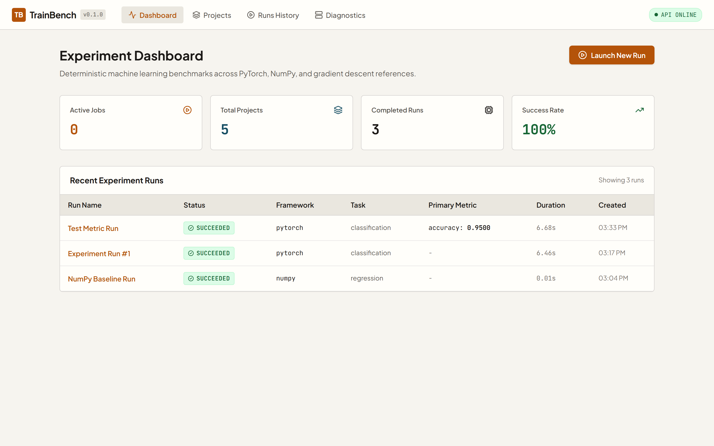
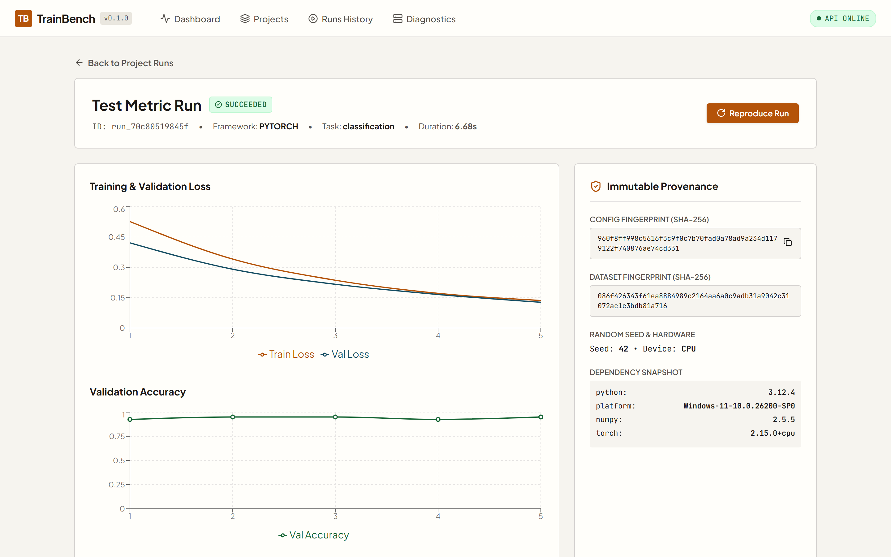
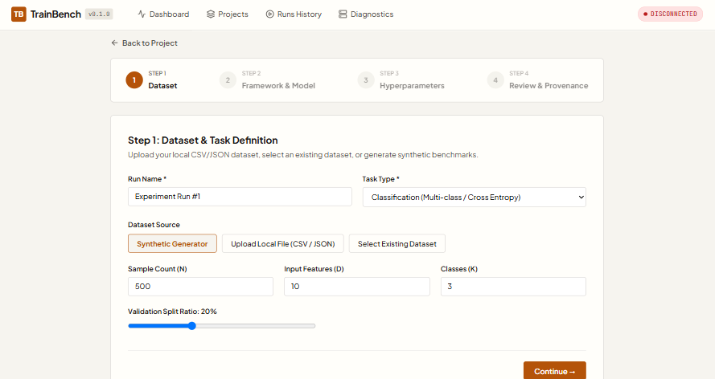
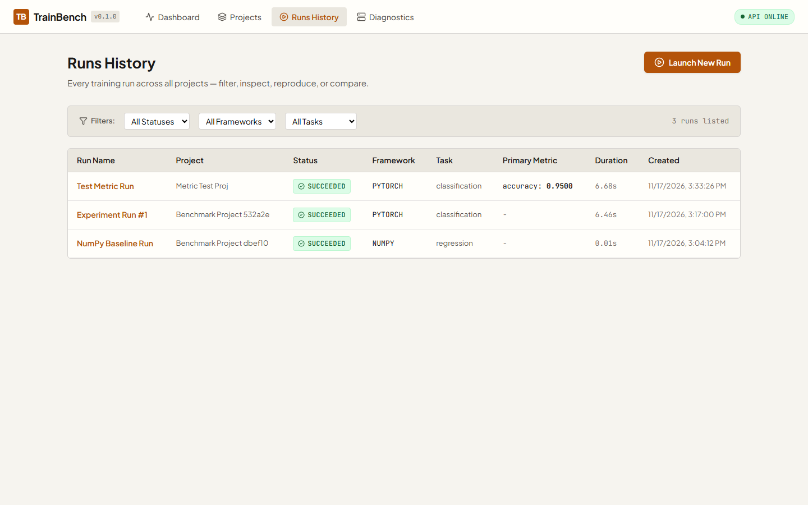
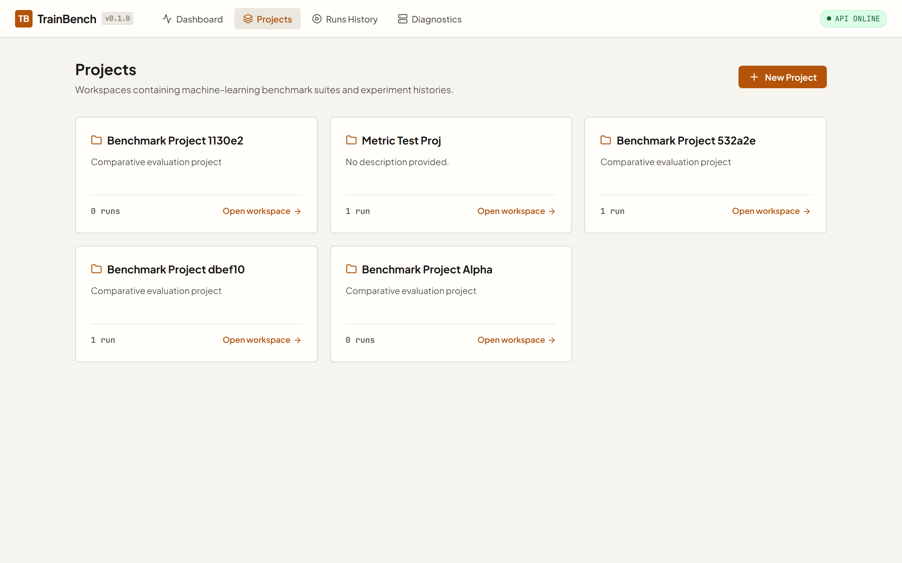
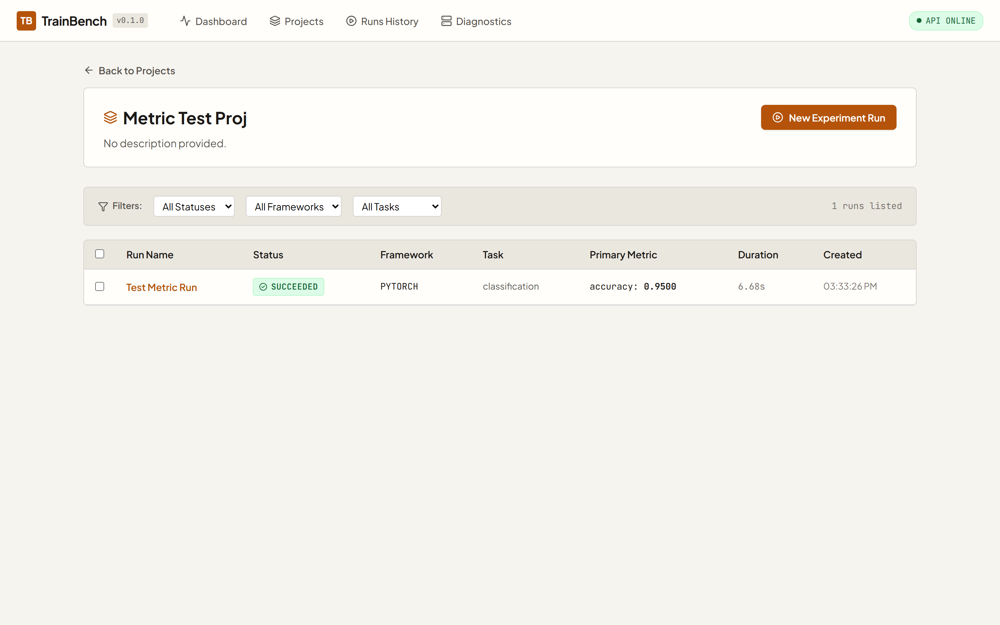
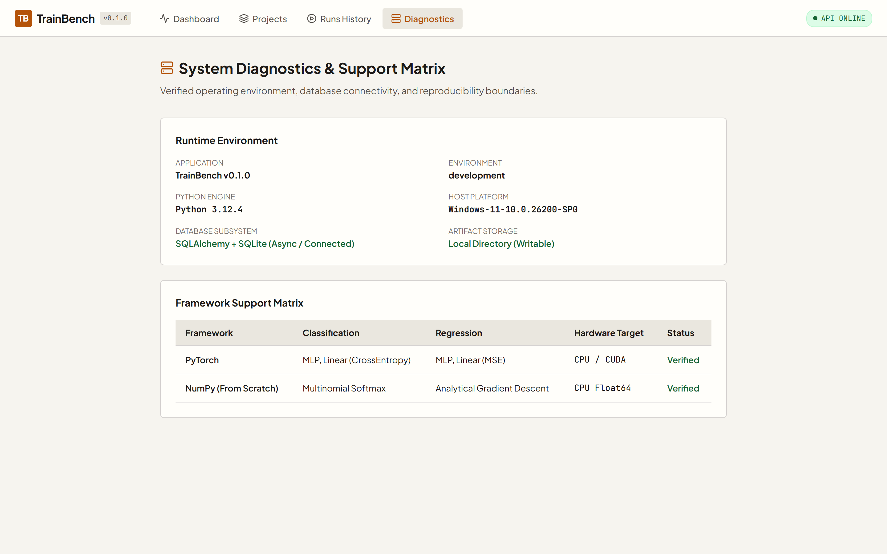
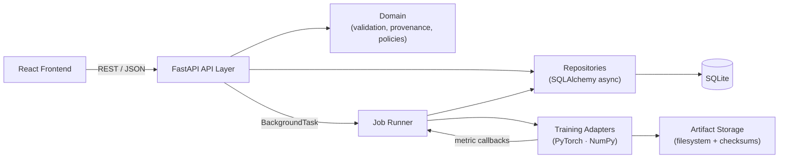

# TrainBench

**A local-first ML training and experiment management platform** for researchers and engineers who need reproducible benchmark runs with full provenance tracking - without cloud lock-in.

TrainBench lets you configure training jobs through a guided 4-step wizard, execute them deterministically, track every metric, compare runs side by side, and reproduce any experiment in a single click. Everything persists in a local SQLite database you own.

---

## Screenshots



*Experiment dashboard with run statistics and recent experiments*



*Run detail view with live loss/accuracy charts and immutable provenance fingerprint*



*4-step run configuration wizard*



*Runs history across all projects with status/framework/task filters*



*Project workspaces with run counts*



*Project detail with filterable run history and run comparison selection*



*System diagnostics: environment, database health, and adapter registry*

---

## Key Features

- **4-step run wizard** - configure framework, task, dataset (synthetic or local CSV/JSON upload), model architecture, and hyperparameters through a validated form before submitting
- **Local dataset upload & schema mapping** - upload CSV or JSON datasets, validate row counts and column types, select prediction target, and train models on your own data
- **Deterministic training** - fixed random seeds, full configuration capture; the same seed + config produces the same result every time
- **SHA-256 provenance fingerprinting** - config hash, dataset hash, and dependency snapshot recorded at run creation time; fingerprints are immutable after the run starts
- **Live metric charts** - loss, accuracy (classification), and R² (regression) plotted per epoch via Recharts; no page refresh required
- **Run comparison** - select two or more completed runs for a side-by-side table of metric deltas and hyperparameter diffs; cross-task comparisons are blocked with a clear error
- **One-click reproduction** - clone any run; the new run is linked to the original via `parent_run_id`
- **Run cancellation** - cancel queued or running jobs; in-flight training checks the cancellation flag between epochs
- **Checkpoint artifacts** - model weights saved at checkpoints with SHA-256 checksum verification; downloadable via the API
- **Diagnostics view** - environment info, database health, adapter registry, and dependency versions surfaced in the UI
- **Zero-config default** - uses a local SQLite database out of the box, no server required

---

## Tech Stack

| Layer | Technologies |
|---|---|
| **Backend** | Python 3.12, FastAPI, SQLAlchemy 2.x (async), aiosqlite, Pydantic v2, uvicorn |
| **ML Frameworks** | PyTorch 2.x (CPU), NumPy |
| **Frontend** | React 19, TypeScript, Vite, Recharts, Lucide Icons |
| **Database** | SQLite (file-based, async via aiosqlite) |
| **Testing** | pytest, pytest-asyncio, httpx (async test client) |

---

## Architecture

TrainBench is built in layered fashion - each layer has a single direction of dependency:

```
frontend/              React SPA (Vite build, served by FastAPI)
│
backend/
├── api/               FastAPI routes, middleware, Pydantic request/response schemas
│   └── routes/        projects.py · runs.py · artifacts.py · health.py
├── jobs/              runner.py (background executor, asyncio bridge)
│                      state_machine.py (run lifecycle transitions)
├── adapters/          pytorch_adapter.py · numpy_adapter.py · base.py · registry.py
│                      synthetic_data.py (deterministic dataset generation)
├── domain/            models.py · validation.py · provenance.py · policies.py
├── persistence/       schema.py (SQLAlchemy models) · repositories.py · database.py
├── artifacts/         storage.py (file I/O + checksum)
├── observability/     diagnostics.py · logging.py
└── config.py          Settings (pydantic-settings, env-var overrides)
```



### Supported Frameworks & Tasks

| Framework | Classification | Regression | Architectures |
|---|---|---|---|
| **PyTorch** | ✅ | ✅ | `mlp`, `linear` |
| **NumPy** | ✅ | ✅ | Gradient descent from scratch |

---

## Prerequisites

- **Python 3.12+**
- **Node.js 18+** and npm
- A Python virtual environment (e.g. `python -m venv .venv`)

> [!NOTE]
> PyTorch is installed as a CPU-only build. GPU training is not currently supported.

---

## Installation

### 1. Clone and set up the backend

```bash
git clone <repository-url>
cd TrainBench

# Create and activate a virtual environment
python -m venv venv
# Windows:
venv\Scripts\activate
# macOS / Linux:
source venv/bin/activate

# Install backend dependencies
pip install -r requirements.txt

# Optional: CPU-only PyTorch wheel on Linux (avoids CUDA downloads):
# pip install torch==2.15.0 --index-url https://download.pytorch.org/whl/cpu

# For running the test suite:
pip install -r requirements-dev.txt
```

### 2. Build the frontend

```bash
cd frontend
npm install
npm run build
cd ..
```

The production build is written to `frontend/dist/` and served automatically by FastAPI.

---

## Running the Server

```bash
python run.py
```

The API and frontend are both available at **http://127.0.0.1:8000**.

The interactive API documentation (Swagger UI) is at **http://127.0.0.1:8000/docs**.

---

## Configuration

All settings can be overridden via environment variables (prefix: `TRAINBENCH_`) or a `.env` file in the project root - see `.env.example` for the full list. A `.env` inside `backend/` is also loaded as a fallback; the project-root file takes precedence.

| Variable | Default | Description |
|---|---|---|
| `TRAINBENCH_DATABASE_URL` | `sqlite+aiosqlite:///./data/trainbench.db` | SQLAlchemy database URL |
| `TRAINBENCH_HOST` | `127.0.0.1` | Server bind address |
| `TRAINBENCH_PORT` | `8000` | Server port |
| `TRAINBENCH_DEBUG` | `false` | Enable uvicorn auto-reload and debug logging |
| `TRAINBENCH_AUTH_ENABLED` | `false` | Enable JWT auth (development mode uses a fixed user ID) |

The database is a local SQLite file at `data/trainbench.db`, created automatically on first run.

---

## API Reference

All endpoints are prefixed with `/api/v1`.

### Projects

| Method | Path | Description |
|---|---|---|
| `GET` | `/projects` | List all projects |
| `POST` | `/projects` | Create a project |
| `GET` | `/projects/{id}` | Get project detail |
| `DELETE` | `/projects/{id}` | Delete a project |
| `GET` | `/projects/{id}/datasets` | List datasets owned by project |

### Datasets

| Method | Path | Description |
|---|---|---|
| `POST` | `/datasets` | Upload a local CSV/JSON dataset with validation & fingerprinting |
| `GET` | `/datasets` | List validated datasets for a project |
| `GET` | `/datasets/{id}` | Get dataset metadata, schema, and validation status |
| `DELETE` | `/datasets/{id}` | Delete an unreferenced dataset (referenced datasets return 409) |

### Runs

| Method | Path | Description |
|---|---|---|
| `POST` | `/runs` | Submit a new training run |
| `GET` | `/runs` | List runs (filterable by project, status, framework, task) |
| `GET` | `/runs/{id}` | Get run detail including config and provenance |
| `POST` | `/runs/{id}/cancel` | Cancel a queued or running job |
| `POST` | `/runs/{id}/reproduce` | Clone a run (links via `parent_run_id`) |
| `GET` | `/runs/{id}/metrics` | Fetch metric time series (filterable by name, split, step count) |
| `GET` | `/runs/{id}/events` | Get the run event log |
| `POST` | `/runs/compare` | Compare two or more runs |

### Artifacts

| Method | Path | Description |
|---|---|---|
| `GET` | `/runs/{id}/artifacts` | List artifacts for a run |
| `GET` | `/artifacts/{artifact_id}/download` | Download a checkpoint file |

### Health & Diagnostics

| Method | Path | Description |
|---|---|---|
| `GET` | `/health` | Liveness check |
| `GET` | `/diagnostics` | Environment, DB health, adapter registry, dependency versions |

---

## Testing

```bash
python -m pytest tests/ -v
```

The test suite covers adapter correctness, provenance fingerprinting, run validation, dataset lifecycle, security, and API endpoints. Tests use a temporary SQLite database and an async HTTPX test client.

---

## Project Structure

```
TrainBench/
├── backend/
│   ├── adapters/          Training adapters (PyTorch, NumPy, base ABC, registry)
│   ├── api/
│   │   └── routes/        FastAPI route handlers
│   ├── artifacts/         Checkpoint storage with checksum verification
│   ├── domain/            Entities, enums, validation logic, provenance hashing, policies
│   ├── jobs/              Background job runner, run state machine
│   ├── observability/     Structured logging, diagnostics endpoint
│   ├── persistence/       SQLAlchemy async schema and repository pattern
│   └── config.py          Pydantic-settings configuration
├── frontend/
│   └── src/
│       ├── features/      Page-level views (Dashboard, Projects, NewRunWizard, RunDetail, Compare, Diagnostics)
│       ├── components/    Shared components (Navigation, StatusBadge)
│       └── api/           Typed API client
├── tests/                 pytest suite
├── docs/                  PRD, requirements, architecture, UI/UX specs
├── data/                  SQLite database and artifact files (git-ignored)
├── run.py                 Server entrypoint
└── pytest.ini
```

---

## Development

### Frontend dev server (hot-reload)

```bash
cd frontend
npm run dev
```

The dev server runs on port 5173 with the backend proxied from port 8000.

### Linting

```bash
# Backend (Pyrefly / Pyright)
# Point your editor at your local virtualenv; Pyrefly picks up
# [tool.pyrefly] settings from pyproject.toml automatically.

# Frontend
cd frontend
npx oxlint .
```

---

## Data Storage

- **Database:** `data/trainbench.db` (SQLite, auto-created on first run)
- **Artifacts:** `data/artifacts/<run-name>/` (checkpoint `.pt` files for PyTorch, `.json` weight files for NumPy)

Both are created automatically; the `data/` directory should be added to `.gitignore`.

---

## License

MIT - see [LICENSE](LICENSE).
